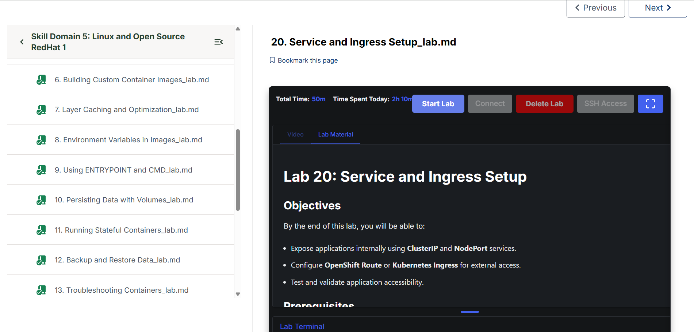
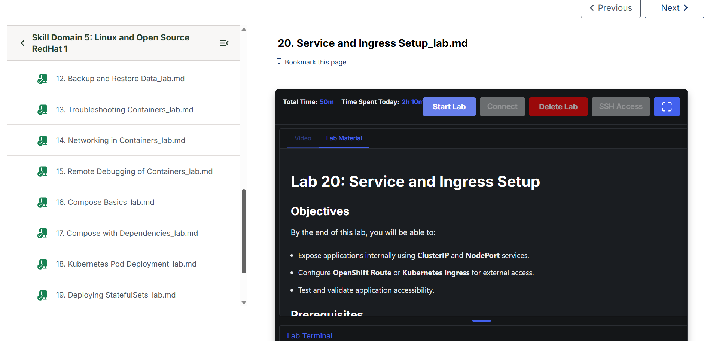

# Evidence Gallery — Red Hat 1 Engineering Journal

**Track:** Domain 5 → Linux and Open Source → Red Hat 1  
**Maintainer:** Hafiz Mohammad Sunasara  
**Reported progress:** Labs 01–19 completed (self-reported)  
**Evidence type:** Screenshots of training-platform progress

This page collects the screenshots currently published in this repository. The images show **Al Nafi lab-list completion indicators** for the Red Hat 1 learning track. They are presented as course-progress evidence—not as independently verified terminal logs or proof of individual test results.

## Course progress screenshots

All three image files are stored **directly inside `evidence/screenshots/`**. Their names and capitalization below match the uploaded files exactly.

### Labs 01–05 — Course progress

[View original screenshot](screenshots/Lab-progress-01-05.png)

**What this shows:** Training-platform completion indicators for the earlier container and Podman exercises.

### Labs 06–13 — Course progress

[View original screenshot](screenshots/Lab-progress-06-13.png)

**What this shows:** Training-platform completion indicators for image building, container configuration, data persistence, backup/restore, and troubleshooting exercises.

### Labs 14–19 — Course progress

[View original screenshot](screenshots/Lab-progress-14-19.png)

**What this shows:** Training-platform completion indicators for container networking, remote debugging, Compose, Kubernetes Pods, and StatefulSets. The Lab 20 page is a next learning step, not part of the completed-Labs-01–19 claim.

## What these images verify — and what they do not

| Evidence | Supported conclusion | Limitation |
| --- | --- | --- |
| Course-progress screenshots | The Al Nafi interface displayed lab completion indicators when captured | They do not show commands, SQL results, Kubernetes resource states, or independently reviewed execution |
| Published lab source and runbooks | Readers can inspect commands, source files, configurations, and expected verification methods | Reproducible documentation alone does not prove a command was executed |
| Retained terminal output (future additions) | Can substantiate a specific observed result | Scope depends on exactly what the output shows |

**Status wording:** "Completed — self-reported" means the learner reports having completed the practical exercise. It is not a production deployment, certification, or independently audited result.

## Where to find the technical work

- [Complete lab index (Labs 01–19)](../labs/LABS-INDEX.md)
- [Engineering Proof of Work — evidence standard](PROOF-OF-WORK.md)
- [Existing engineering journal — 19 October 2026](../journals/2026-10-19.md)
- [Structured learning progress](../progress/labs-progress.json)
- [Repository homepage](../README.md)

## Adding stronger evidence in future labs

For new exercises, include **1–2 genuine terminal screenshots** when useful: a command or configuration, and the actual validation result. Keep them beside the relevant lab or link them here. Check for exposed passwords, tokens, private addresses, and personal information before publishing.

---

**Evidence policy:** No fabricated screenshots, command output, benchmarks, test results, or claims of professional production experience.
