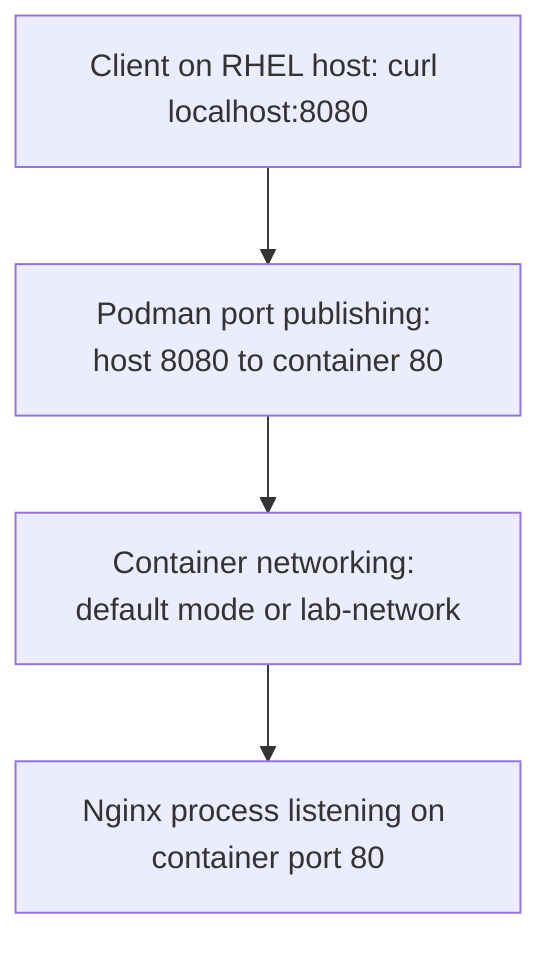

# Lab 14 — Engineering Deep Dive: Podman Container Networking

> **Domain 5 → Linux and Open Source → Red Hat 1**  
> **Companion practical runbook:** [README.md](README.md)  
> **Status:** Completed — **self-reported**, with no separately verified terminal artifacts supplied for this write-up.  
> **Scope:** Linux containers, network namespaces, bridge networking, port publishing, inspection, troubleshooting and security.

## 1. The engineering problem

Running an image is not the same as delivering a reachable service. An Nginx process can start and bind to `:80` inside its container while a browser outside the container still cannot reach it. The infrastructure engineer must identify:

1. Which **network namespace** the process uses.
2. Which **network** the container is attached to and how addresses/routes are provided.
3. Whether the process is actually **listening** on the expected port.
4. How that port is **published** to the host.
5. Which **machine** is the client: inside the container, inside the RHEL VM, on the Windows host, or on another system.
6. Whether a **firewall, forwarding rule or security policy** permits the intended connection.

This lab introduces these questions using the Podman CLI instead of treating a successful `podman run` as proof that networking works.

## 2. Visual model: container service versus host-published service



The arrows represent logical packet forwarding/reachability, **not** a claim that every Podman network backend implements those paths with the same kernel NAT, userspace relay, address, or interface.

### Three pieces people often confuse

- **Container port:** The TCP/UDP port a service listens on inside the container's network namespace, e.g. `80`.
- **Host port:** The published port on the Linux environment running Podman, e.g. `8080`.
- **Container IP:** An address the runtime may allocate to a network interface, depending on network mode. This alone does not publish the container's service to the host or the internet.

Read `-p 8080:80` from **outside in**: *host port 8080 → container port 80*. It does not mean the Nginx configuration is changed to listen on 8080.

## 3. Linux network namespaces in practical terms

A Linux network namespace gives processes a separate view of networking objects, which can include interfaces, IP addressing, routes, port bindings, and connection-tracking context. A container commonly operates inside a dedicated namespace (exceptions exist, e.g. host networking or pod network namespace sharing).

This explains a frequently surprising result:

- `localhost` **inside** the Nginx container refers to that container/pod's network namespace.
- `localhost` on the **RHEL host** refers to the RHEL host's namespace.
- `localhost` on the **Windows machine running VirtualBox** refers to Windows itself, not automatically the RHEL guest.

Publishing ports bridges these worlds by configured forwarding/exposure. A VM adds a **second** networking boundary. A successful `curl http://localhost:8080` in the RHEL VM does not imply the Windows browser can open that same localhost URL.

## 4. Networks, bridges, IPAM, routing and DNS

A common Podman setup uses a managed bridge for a custom local network. Conceptually:

```text
             RHEL host / Podman context
                       |
              [lab-network]
               /        \
         [webapp]     [another service]
          Nginx           app client
```

A bridge-backed network may give endpoints addresses from a subnet, provide a gateway, install routes, and support name resolution through a network-aware DNS service. The exact plumbing depends on Podman version, backend (e.g. Netavark or older CNI), privileges, and platform.

### Why IPAM matters

IP Address Management (IPAM) determines how addresses/ranges are allocated. On inspection, look for:

- **Network/subnet:** Which addresses are available, e.g. a CIDR block.
- **Gateway:** Which address can serve as a route toward other networks, if configured.
- **DNS configuration:** Whether/how container names are resolved within the network.
- **Driver/backend:** Which mechanisms implement the network.

If two networks overlap with existing host/VM routes, traffic can behave unexpectedly. Diagnose address ranges before assuming `curl` or Nginx is broken.

### Network creation is not container attachment

`podman network create lab-network` defines a network. It does not move pre-existing containers into it. You attach a container during creation with `--network lab-network`, or when supported attach an existing container with `podman network connect lab-network CONTAINER`.

## 5. Rootless Podman: do not over-generalize the default network

Rootless Podman executes containers without an always-privileged container daemon. Networking can differ materially from rootful bridge operation. Depending on version and configuration, a rootless container can use `pasta`, `slirp4netns`, or a user-defined network powered by the configured backend.

**Consequences:**

- The existence of a network named `podman` in `podman network ls` does not prove a specific rootless container is attached to it.
- Port publishing may be performed with user-space mechanisms and can have different source-IP or forwarding behaviors.
- Some network operations/features differ across environments and Podman releases.
- Do not mix `sudo podman ...` and unprivileged `podman ...` indiscriminately: they use separate storage, containers, and networks. A container created rootless might be invisible to `sudo podman ps`, and vice versa.

Use **the same Podman identity/context** consistently for listing, creating, running, inspecting and cleaning up your lab resources.

### Diagnostic questions

```bash
podman info
podman network ls
podman ps -a
```

Ask: Is Podman rootless? Which backend is configured? Does the requested network exist **in this context**? Is the container actually attached? Avoid stating a specific `podman info` JSON field without checking the installed version.

## 6. Deep dive on the instructor commands

### 6.1 `podman network ls`

This is discovery: it answers **which managed networks exist in the current Podman context**. A short list does not tell you which one a given container is using.

### 6.2 `podman network inspect podman`

This is configuration inspection. The returned JSON may identify the driver, subnet allocation, gateway, DNS, and other properties. The exact schema evolves. If `podman` is absent, inspect the network that actually exists; do not hardcode an expected subnet.

### 6.3 `podman network create lab-network`

This defines a named network, normally a bridge network with parameters allocated by the runtime when no explicit options are supplied. It does **not** create an application, server, or guaranteed externally reachable service.

### 6.4 `podman network ls | grep lab-network`

This is a quick **text filter** over network listings. It helps confirm an expected name exists, but substring matching is not a robust API contract. For machine-readable checks, prefer structured output or inspect the exact named network.

### 6.5 `podman network inspect lab-network`

Validates the custom network definition and reveals the networking parameters you should inspect during failure analysis.

### 6.6 `podman info`

A broad diagnostic command. It can provide useful engine/environment context, but if `network create` failed, **start with the actual error message** and then use this command to narrow possibilities such as privilege, backend, address conflicts or configuration.

### 6.7 `podman run -d --name webapp -p 8080:80 docker.io/library/nginx`

- `-d` detaches from the process; it does **not** prove application health.
- `--name` assigns a unique **container object name**, not a network DNS guarantee in every configuration.
- `-p` requests port publication. The host binding can be broader than intended without an explicit host IP.
- `docker.io/library/nginx` uses the official image path. Without a pin, the default tag can change over time; a serious reproducibility workflow should consider pinning a suitable supported version or digest.

For safer local testing, `-p 127.0.0.1:8080:80` avoids broad-interface binding where supported. If users on another machine must connect, design the exposure intentionally and use firewall/security controls.

### 6.8 `curl http://localhost:8080`

This probes **HTTP from the environment executing `curl`**. It combines multiple questions: Is there a listener? Does traffic reach a container? Does Nginx respond? A successful HTML response is stronger than “the container is Running,” but still does not validate external traffic, TLS, high availability, throughput or authentication.

### 6.9 `podman ps` / `sudo firewall-cmd --list-ports`

`podman ps` confirms currently running containers (use `-a` for exited containers). Firewalld's explicit-port list is relevant mostly when analyzing **network exposure to other hosts**, and doesn't by itself prove whether `localhost` forwarding works. Different firewalld zones, rich rules or backend behavior may matter.

### 6.10 `podman stop webapp`

`stop` sends a shutdown request and marks a container stopped. The container record, including its **name reservation**, continues to exist. You can inspect/restart it; you cannot create another container with the same name while it still exists.

### 6.11 Why the instructor's relaunch command needs a correction

The handout follows `podman stop webapp` immediately with:

```bash
podman run -d --name webapp -p 8080:80 --network lab-network docker.io/library/nginx
```

That can fail because `webapp` is already taken. For this **throwaway, stateless lab**:

```bash
podman stop webapp
podman rm webapp
podman run -d --name webapp -p 8080:80 --network lab-network docker.io/library/nginx
```

On a stateful service, first review its mounted volumes/data and replacement plan. Stopping/removing a real container is an operational action, not a harmless documentation step.

### 6.12 `podman inspect webapp | grep -A 5 "Networks"`

This searches human-readable JSON text. It is a useful quick exploration but fragile as validation: JSON structure can change, and `-A 5` might not include the actual network entry. A clearer companion is:

```bash
podman inspect webapp --format '{{json .NetworkSettings.Networks}}'
podman port webapp
```

Do not equate “the network exists” with “the container joined it.” Check the **container** as well as the network.

## 7. Packet-flow reasoning: what does `curl` actually test?

A conceptual request path for this lab:

1. The host-side client resolves `localhost` to a local host address.
2. The client opens a TCP connection to host port `8080`.
3. Podman-configured networking/port forwarding directs the connection toward the container's port `80`.
4. Nginx accepts the HTTP request and returns an HTTP response (typically HTML).
5. The response travels back through the established connection path.

The exact mechanisms (kernel rules, sockets, user-mode forwarding) depend on backend. If any step fails, the symptom can differ:

| Symptom | Investigate |
| --- | --- |
| DNS error | The hostname being used and which namespace resolves it |
| Connection refused | Listener/process state, published port and correct host context |
| Connection timeout | Routing, firewall, VM networks, policy and endpoint reachability |
| HTTP 404 | Service is reachable; now investigate Nginx path/content configuration |
| HTTP 502/503 in a more complex stack | Proxy or upstream health, not necessarily base port publishing |
| Works from VM but not Windows | VirtualBox adapter mode, VM-host accessibility and deliberate forwarding |

The distinction between **TCP-level connectivity** and **application-level HTTP correctness** is fundamental to production debugging.

## 8. Network isolation and attack-surface reduction

A custom network is a useful grouping and potential isolation boundary, but don't describe it as a blanket security guarantee. Effective isolation depends on runtime semantics, IP forwarding, policies, host configuration and service-level access control.

**Consider these principles:**

- **Publish only required ports.** A database used only by an application container often doesn't need a public host port.
- **Bind narrowly.** For a one-machine lab, `127.0.0.1:8080` is preferable to broad exposure when appropriate.
- **Segment services intentionally.** Separate networks where the application architecture and security policy require it.
- **Avoid credentials in logs/commands.** Networking diagnostics shouldn't accidentally dump secrets to an open repository.
- **Use TLS/authentication for actual services.** Publishing a port does not add encryption or authentication.
- **Pin images thoughtfully and keep them updated.** Reproducibility and vulnerability management matter independently from networking.

## 9. Root-cause analysis workflow used by working engineers

Do not start by editing random firewall rules or deleting containers. Use evidence in order:

**Stage A — container:**

```bash
podman ps -a --filter name=webapp
podman logs webapp
```

Is the intended container running? Are there startup errors? `Running` alone does not guarantee the service is ready.

**Stage B — port binding:**

```bash
podman port webapp
ss -ltn
```

Which host port/interface is configured? Could another process occupy the requested port? Confirm TCP vs UDP assumptions.

**Stage C — network membership:**

```bash
podman network ls
podman network inspect lab-network
podman inspect webapp --format '{{json .NetworkSettings.Networks}}'
```

Does the custom network exist? Is the container actually assigned? Do address ranges conflict with host routes?

**Stage D — application probe:**

```bash
curl -v http://localhost:8080
```

Which phase fails: resolution, connect, HTTP handshake or returned content? Capture the error, not just “it doesn't work.”

**Stage E — boundaries:**

If the client is on Windows and Podman is inside RHEL VirtualBox, test inside the RHEL VM **first**. Then separately investigate host-only/bridged/NAT mode, VM accessibility, VirtualBox port-forward rules and host/guest firewalls. Avoid assuming Windows `localhost` is the same interface as the RHEL VM.

**Stage F — least-disruptive correction:**

Change one identified cause at a time, rerun the failed observation, and retain the before/after result if publishing evidence. This prevents coincidence from being mistaken for root cause.

## 10. Real engineering scenarios

### Scenario A — website loads inside Linux VM but not from laptop browser

**Potential cause:** The HTTP forwarding exists **within the RHEL VM**, but VirtualBox is configured in NAT mode and the host cannot reach the VM's guest-local endpoint by using Windows `localhost`.

**Approach:** Confirm `curl` in the VM, inspect guest interfaces and adapter mode, and configure explicit host-to-guest access appropriate to the environment. Avoid simply opening all firewall ports.

### Scenario B — second run says `webapp` already exists

**Cause:** The previous container was stopped but never removed. The name is reserved by stopped containers as well.

**Approach:** Inspect `podman ps -a`; if it is this lab's disposable Nginx container, remove it and recreate it on `lab-network`. For persistent workloads, plan data integrity and rollback first.

### Scenario C — service runs, but custom network is missing

**Cause:** Network was created with different privilege context, network name was mistyped, or the container was started without `--network lab-network`.

**Approach:** Inspect as the same Podman user; list networks; check exact flags; compare container network settings.

### Scenario D — a container is reachable from the whole LAN unexpectedly

**Potential cause:** A broad-interface port publication like `-p 8080:80`, combined with VM/host firewall and network accessibility, exposed the service wider than intended.

**Approach:** Explicitly bind to localhost for local-only tests and verify from intended/not-intended clients. Apply suitable firewall/authentication controls; do not assume port publishing itself adds access restrictions.

### Scenario E — two containers need to communicate by service name

**Approach:** Use a suitable user-defined network, attach both containers, and verify network DNS support. Name-based discovery is more maintainable than assuming a stable container IP, but depends on the configured backend and actual DNS behavior.

## 11. Optional hands-on extension: two services on one network

This is **not** part of the original Lab 14 and was not claimed executed. Use a second disposable client on the same custom network to explore service-to-service DNS/HTTP connectivity:

```bash
# Only after lab-network and the webapp container exist and webapp is attached:
podman run --rm --network lab-network docker.io/library/alpine:3.20 \
  sh -c 'wget -qO- http://webapp:80 | head -n 3'
```

This assumes the backend supports network DNS for container names, `wget` is present in the selected Alpine image, and the Nginx container is reachable. If not, inspect `podman network inspect lab-network` and verify name resolution rather than asserting a pass.

For the originally suggested **next step**, `podman network connect lab-network webapp` connects an existing container to the custom network; check the container's current connections before running it to avoid unnecessary changes.

## 12. Connection to Kubernetes and OpenShift

Podman network labs teach transferable **fundamentals**, but there isn't a one-to-one mapping between a Podman `bridge` network and Kubernetes networking APIs.

- **Container port:** Analogy to a port listened to by a workload; Kubernetes `containerPort` declaration documents an expected port but doesn't by itself publish it.
- **Pod networking:** Containers in the same Kubernetes Pod share a network namespace, like Podman containers in a pod can share namespace(s).
- **Service discovery:** Kubernetes Services/DNS provide an abstraction for reaching dynamic Pods; this differs from simple single-host container DNS.
- **Exposure:** Kubernetes Ingress/Gateway/LoadBalancer/NodePort mechanisms solve different problems; don't equate them mechanically to `-p 8080:80`.
- **OpenShift:** Platform networking, routes, policy enforcement and cluster CNI implementations add multi-host layers absent from this local exercise.

A strong engineer learns the underlying layers first, then examines what the orchestration platform automates or changes.

## 13. Knowledge-check / interview questions with concise answers

1. **Why might Nginx work inside the container but `curl localhost:8080` fail on the host?** Missing/incorrect port publication, wrong host context, app not listening, conflict or forwarding/routing problems.
2. **What does `8080:80` mean?** Host port 8080 forwarded to container port 80.
3. **Does `-d` guarantee a live Nginx website?** No. It detaches; the application can fail or exit.
4. **What does `podman network create` do?** Creates a managed network, not an automatically attached container.
5. **What is the difference between `podman network ls` and `network inspect`?** Discovery vs configuration detail.
6. **Is every rootless Podman container on the `podman` bridge?** No; default networking may use `pasta`/`slirp4netns`, and user-defined networks vary.
7. **Why did `podman run --name webapp` fail after `podman stop webapp`?** The stopped container still exists and owns the name.
8. **When is `podman rm` risky?** When it deletes important non-persistent writable-layer state or breaks a workload.
9. **What does `--network lab-network` control?** The network selected for the new container at creation.
10. **What does `podman network connect` do?** Adds a network connection to an existing container where supported.
11. **Is port publishing required for two containers on the same user-defined network to communicate?** Not necessarily; publishing is primarily for exposure outside that container network.
12. **Why is `grep -A 5 "Networks"` fragile?** Text-based truncation of JSON doesn't reliably validate the network assignment.
13. **Why might Windows `localhost:8080` fail while RHEL VM `localhost:8080` works?** Different hosts/network namespaces separated by virtual networking.
14. **Should you always use `sudo firewall-cmd --list-ports` as your first HTTP diagnostic?** No; inspect process and port bindings, then boundary-specific firewall configuration.
15. **What's the security concern with `-p 8080:80`?** It may expose the service across host interfaces without deliberate restriction.
16. **What's the difference between bridge and host network mode?** Bridge mode uses separate networking and forwarding/attachment; host mode shares the host network namespace and has different isolation/exposure implications.
17. **Can custom-network separation replace TLS or authentication?** No.
18. **What would prove the lab's core networking objective?** A successful HTTP probe with an inspected attached custom network and known published port, captured from the intended environment.

## 14. What this lab does—and does not—prove

**This lab covers:** local Podman networks, inspection, Nginx port publishing, network assignment, common lifecycle mistakes, and networking diagnostics.

**It does not independently prove:** production reliability, secure public exposure, multi-host routing, DNS-based microservices, zero downtime, benchmarked performance, tested Kubernetes/OpenShift deployments, or external accessibility. Those require separate controlled experiments and real evidence.

## Further learning

- [Podman documentation](https://docs.podman.io/) — inspect the CLI documentation matching your installed version.
- [Lab 14 practical README](README.md) — instructor task coverage, commands and the reproducible Task 3.3 correction.
- [All Red Hat 1 labs](../LABS-INDEX.md) — learning journal index.
- [Engineering Proof of Work](../../evidence/PROOF-OF-WORK.md) — evidence integrity and self-reporting standard.

---

**Maintainer:** Hafiz Mohammad Sunasara · **Training track:** Domain 5 / Linux and Open Source / Red Hat 1
