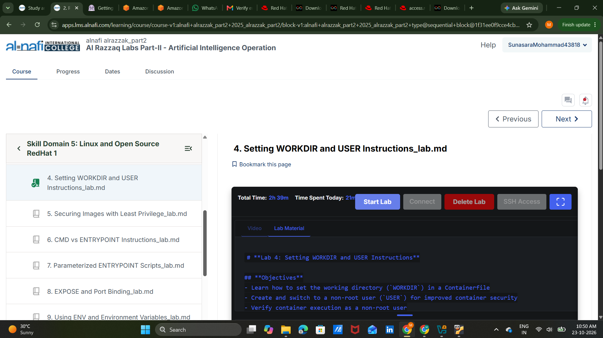

# Lab 04 — Evidence and verification status

## Retained screenshot

**Source:** Screenshot supplied by the learner, dated 23 October 2026 (per visible session context). The course navigation shows a green completed marker next to **"4. Setting WORKDIR and USER Instructions"**.

**What it supports:** The course UI displayed Lab 04 as completed at screenshot time, and the learner reports the exercise finished.

**What it does NOT independently prove:** Successful Podman image builds, actual `whoami`/UID output, `/app` ownership, expected `/root` permission denial, or process inspection. No terminal transcript for this lab was supplied with the request.

## How to improve proof later (optional)

If you reproduce the work on a local Ubuntu VM, capture up to 2–3 authentic screenshots:

1. `podman run --rm workdir-demo cat /tmp/workdir.log` showing `/app` and `root`.
2. `podman run --rm nonroot-demo id` plus `/tmp/user.log` showing the non-root runtime identity and ownership.
3. The expected `/root/blocked-file` denial and `podman top testuser` or `podman exec testuser id`.

Never substitute expected command output for actual evidence, and avoid uploading usernames, secrets, cloud account IDs, IPs or tokens unnecessarily.
